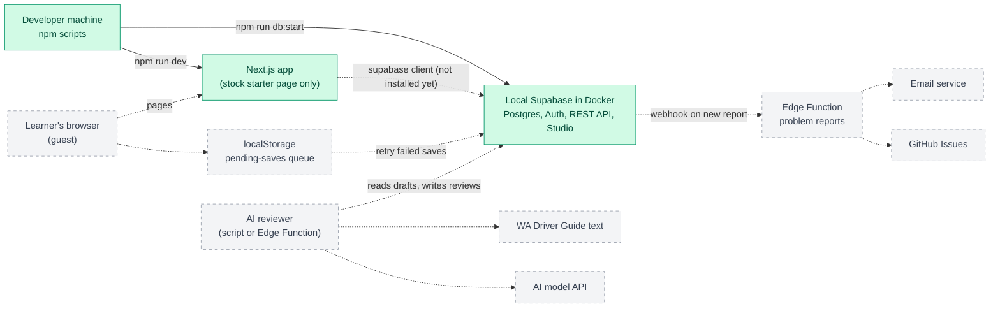
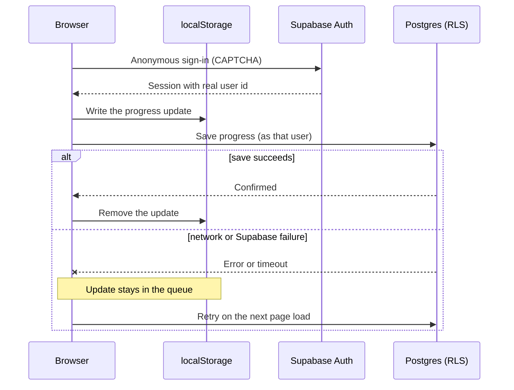
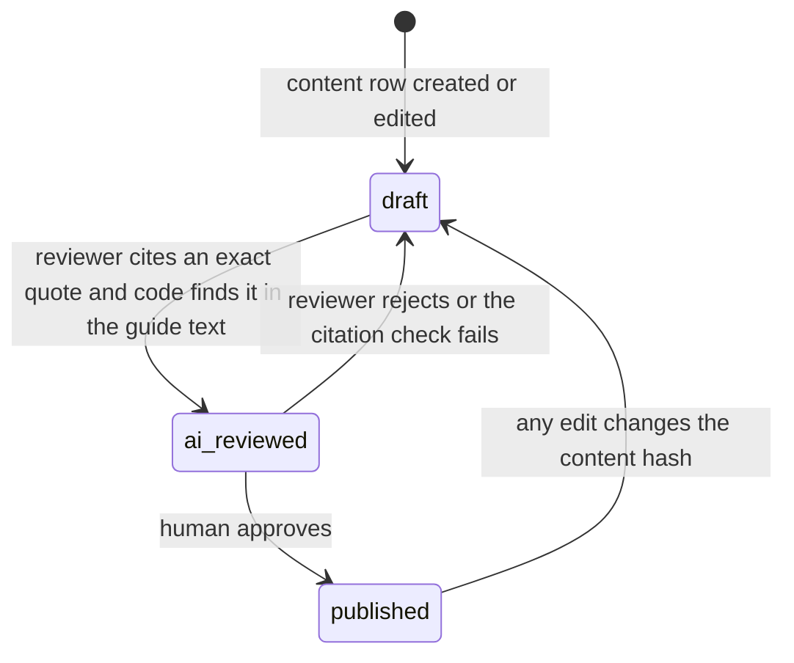
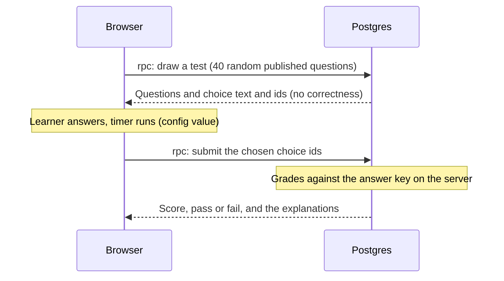
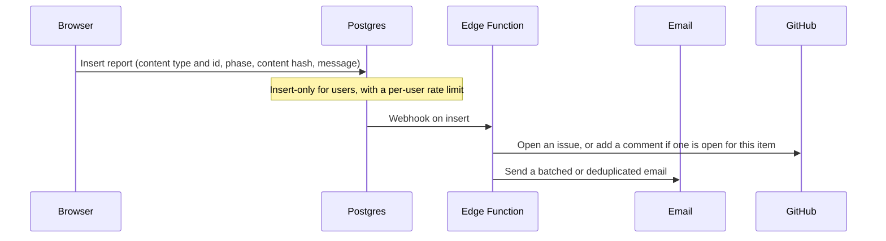
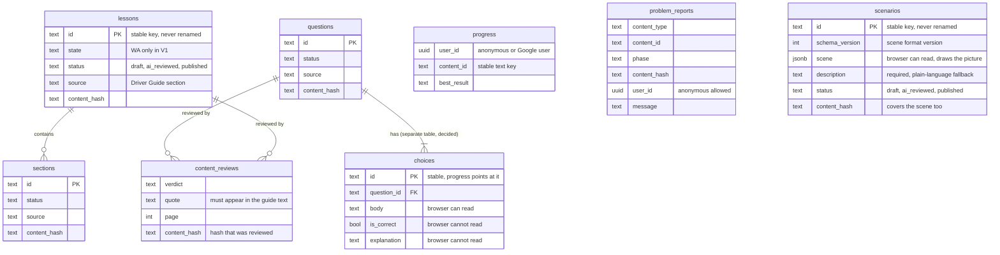
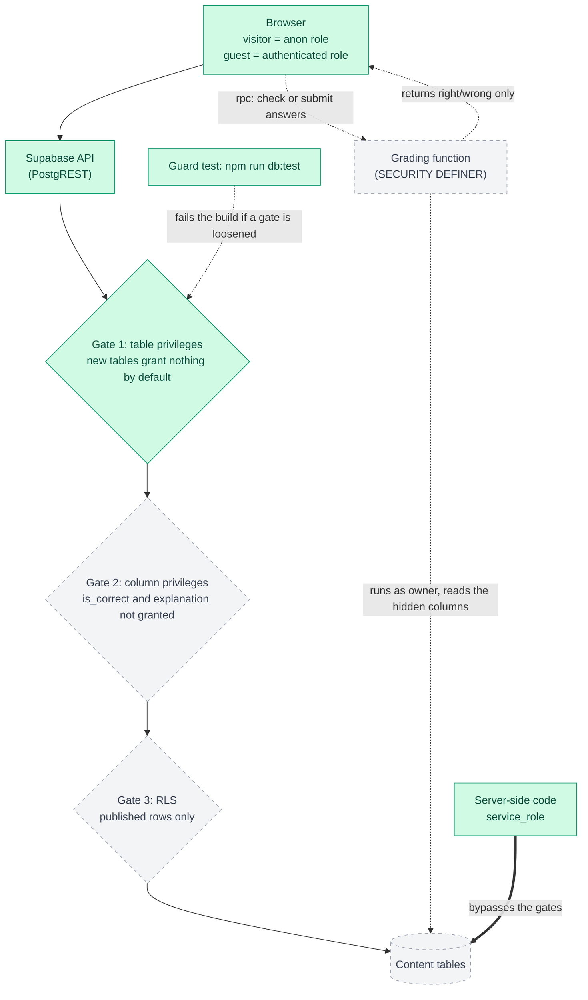
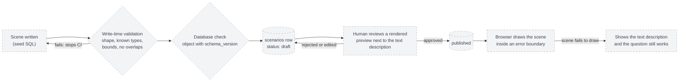

# Data flow

Status labels: **built**, **planned**, **pending decision**. Planned parts are dashed and grey. See [README.md](README.md) for how to update this file.

Last checked against the repo: 2026-11-07.

## 1. System overview

What exists today versus what is planned.

**Reading it:** today the Next.js app and the local database are two separate things that do not talk to each other. The app has no Supabase client and the database has no tables or migrations. Every dashed line is a decision that is made but not built.

## 2. Guest sign-in and saving progress (planned)

Supabase is the source of truth. localStorage only holds saves that failed, until they succeed.

**Failure notes:**

- If sign-in itself fails, saves cannot be attributed to a user, so they wait in the queue.
- Clearing browser data deletes both the Supabase session and the queue, so that guest's progress is lost (accepted for V1).
- If the queue and Supabase disagree, the merge keeps the best result per item. The same merge function is reused for V2 account merging.
- Every retry must be safe to repeat, so a duplicate save does not corrupt progress.

## 3. Content publishing pipeline (planned)

Review happens once at write time, not on every page view.

**What it enforces:** the read policy only exposes `published` rows, so learners cannot see unreviewed content. The reviewer only runs when a row's content hash differs from the last reviewed hash, so unchanged content is never reviewed or paid for twice.

## 4. Practice test (planned, one part pending decision)

The test draws 40 questions at random from the whole pool and needs 80% (32 of 40) to pass.

**Answer visibility (decided, option A):** the correct answer must not be readable in the browser, so grading happens on the server. `is_correct` and `explanation` sit on `choices`, but the browser roles can only select `id`, `question_id` and `body`, and a `SECURITY DEFINER` function does the grading. This was tested against local Supabase and held up.

**Pending design, per-choice checking:** the "check your understanding" questions inside lessons need a check one question at a time. But a per-choice check is an answer-key oracle: anyone can loop over the choice ids and learn which is correct (shown in testing). That is acceptable in lessons, but the practice test must grade the whole submission at once, and test questions need protection from per-choice checking. How is not designed yet.

**Failure notes:** if submitting fails, answers stay in the browser and the learner can retry. If the timer config is missing, a default must be used. A test with fewer than 40 published questions in the pool must fail clearly instead of returning a short test.

## 5. Report a problem (planned, owner: Collins)

**Failure notes:**

- If GitHub or email is down, the report is still safely stored in the table, and the function must be able to retry later without opening a duplicate issue.
- The GitHub token (fine-grained, Issues write only) and the email key live only as Edge Function secrets, never in the browser.
- Users can insert reports but can never read anyone else's.

## 6. Data model (draft, not final, nothing built)

**Open points (from `CLAUDE.md`):**

- How questions attach to lessons and sections is undecided, so that edge is not drawn.
- `is_correct` and `explanation` are on `choices` but have no browser access (column-level privileges, option A). Whether `choices` carries its own published status or follows its question's is not decided.
- The progress table name and shape are placeholders.
- `scenarios` is drawn but not connected: how a scenario attaches to a question (which holds its choices and hidden answer) is undecided, so that edge is not drawn. The solution is never stored on the scenario.
- Progress rows reference stable text ids and choice ids, never array positions.

## 7. Who can reach what: access control layers

Every browser request passes the same gates before it touches data. Only the first gate and its guard test exist today; the tables behind them are planned.

**What it shows:** a request is refused at the first gate that says no. Gate 1 is now built: a migration makes new tables, sequences and functions closed to the browser roles until a later migration grants access on purpose. Gates 2 and 3 are planned with the `choices` and content tables. The grading function is the only way the browser learns whether an answer is right, and it only gets back right or wrong.

**Why this shape:** the browser holds a public key, so the database has to enforce access. RLS limits rows and column privileges limit columns, and we need both. Server-side code uses `service_role` and bypasses the gates, so that key must never reach the browser.

**Failure notes:**

- A forgotten grant fails closed: the developer sees "permission denied" and the data stays hidden.
- Someone granting too much on purpose, or following the misleading error hint that suggests a table-wide `SELECT`, is caught by the guard test, which fails if a table lacks RLS, an answer column is readable, or a function is callable without being on the allow-list.
- A per-choice check is an answer-key oracle if someone loops over it, so the practice test has to grade the whole submission at once (design pending).
- Not verified: GraphQL (extension off locally) and the hosted project's default grants.

## 8. Scenario data: validation and fallback (planned)

A scenario scene is data drawn in the browser, so bad data has to be stopped early and must never leave the learner stuck.

**What it shows:** three places a bad scene can be caught (when written, in the database, and while drawing), plus the human check. Any edit changes the content hash, which returns the scenario to `draft`.

**Failure notes:**

- The AI reviewer checks the written explanation against the Driver Guide but cannot see the picture, so the human preview is the only check that the scene matches its description.
- If the scene fails to draw, the learner still sees the required text description and can answer, so a bad scene degrades a lesson instead of blocking it.
- The scene format carries a `schema_version`, so old and new formats can coexist when the format changes.
- Not verified: whether the database-level JSON-schema extension (`pg_jsonschema`) is available locally; the first version may validate in a script instead.
