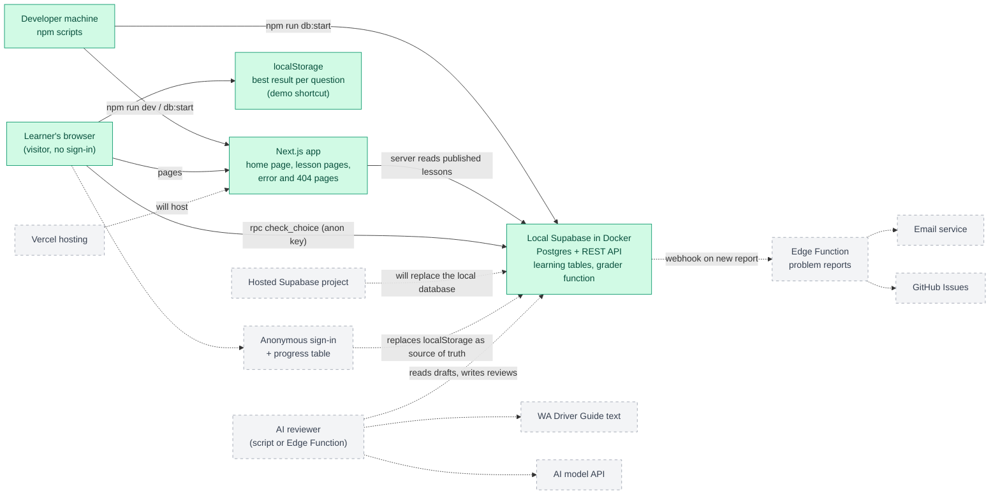
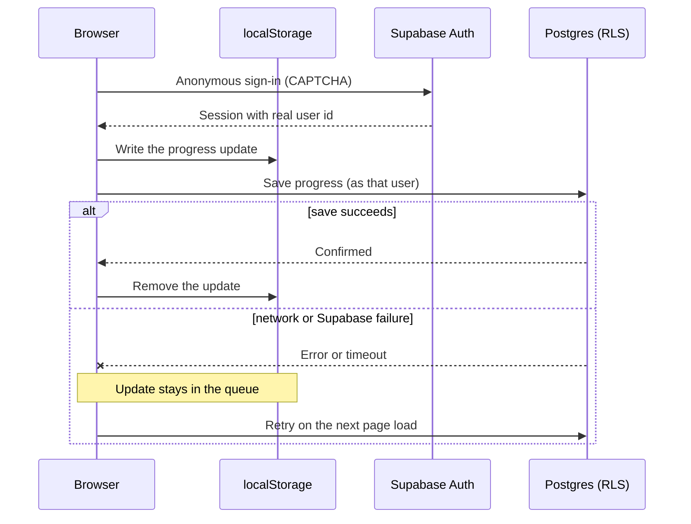
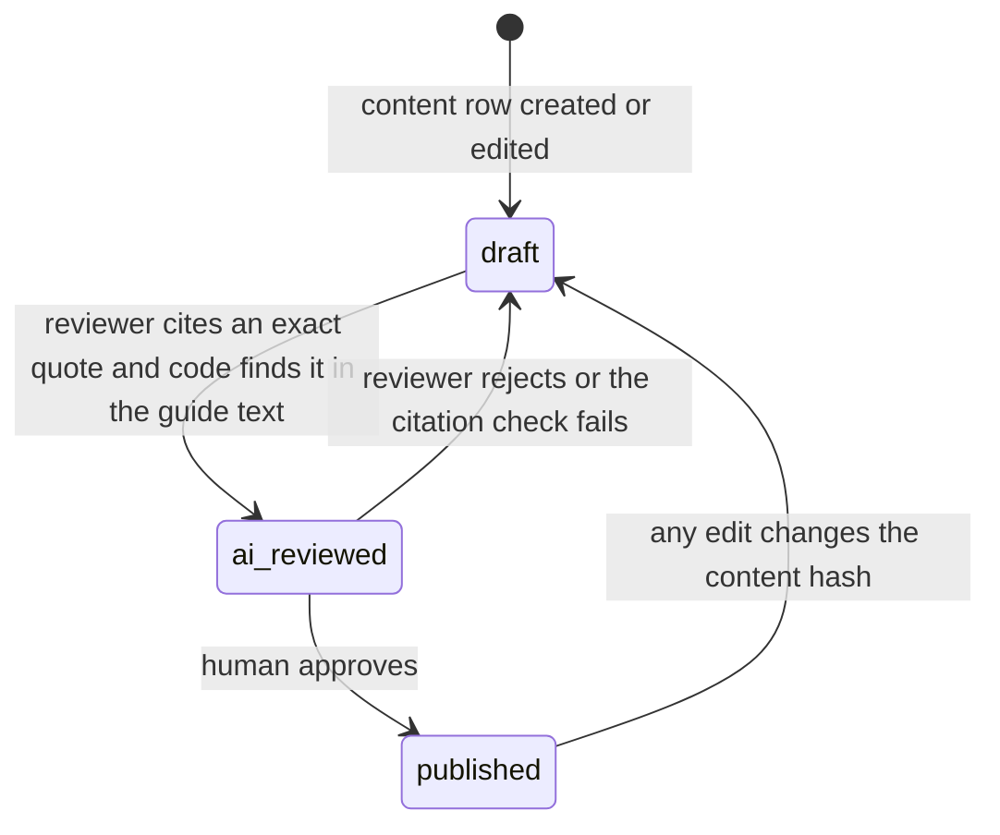
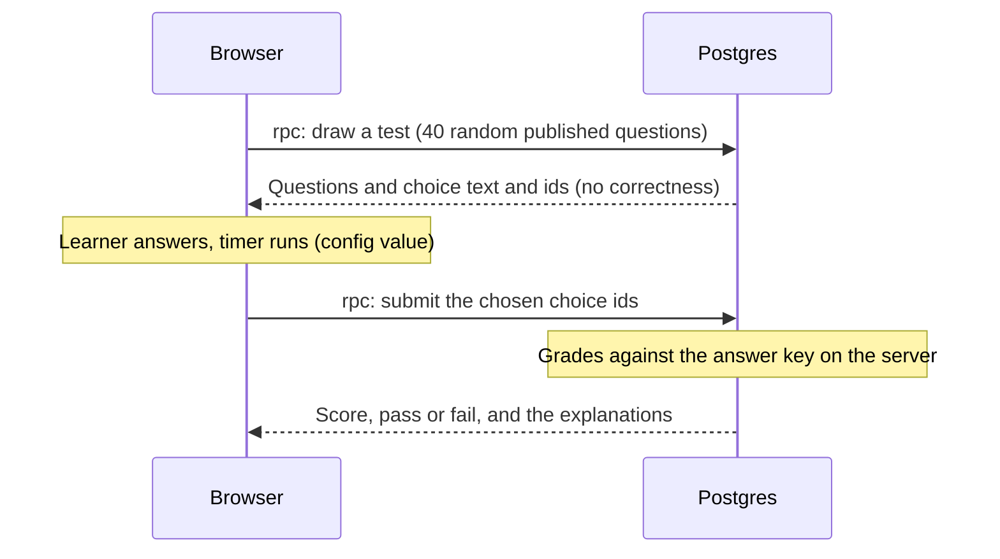
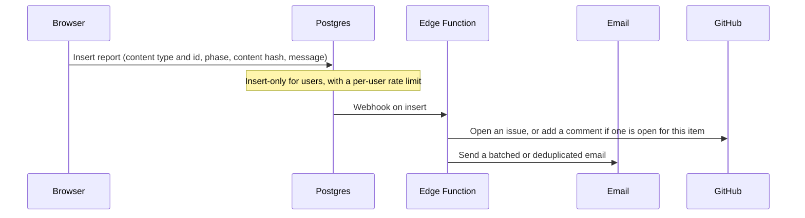
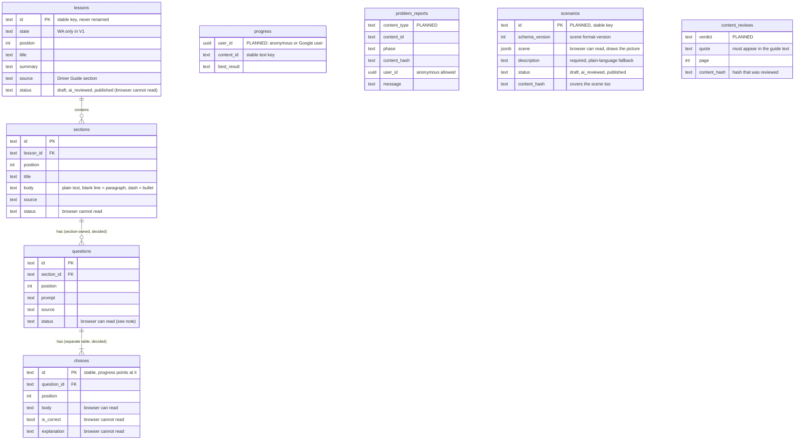
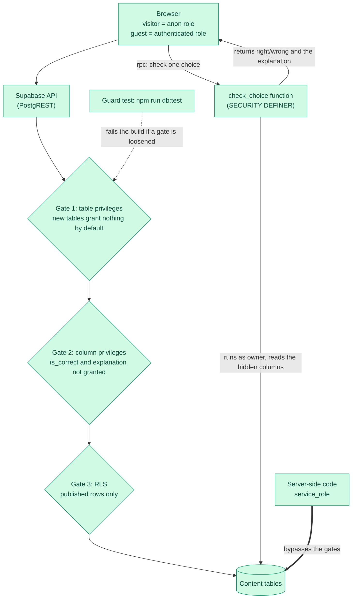
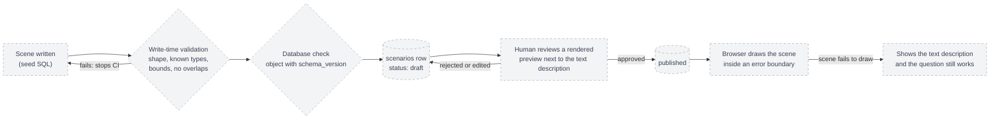
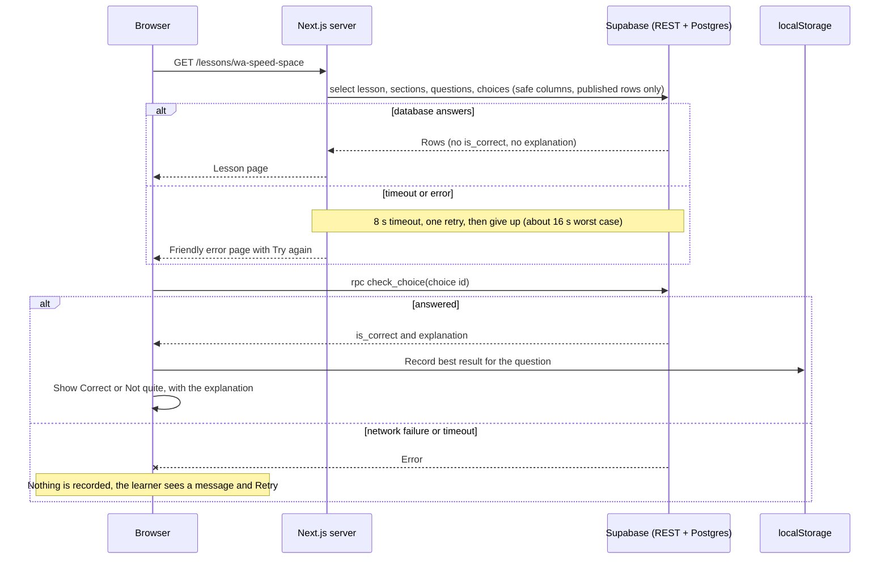

# Data flow

Status labels: **built**, **planned**, **pending decision**. Planned parts are dashed and grey. See [README.md](README.md) for how to update this file.

Last checked against the repo: 2026-11-08.

## 1. System overview

What exists today versus what is planned.

**Reading it:** the learning slice is built and runs locally. Lesson pages are rendered on the server from published rows in Supabase. The browser asks the database to grade each answer, and progress is kept only in this browser's localStorage, which is a temporary shortcut (see section 9). Hosting, sign-in with saved progress, the AI reviewer and problem reports are still planned. Every dashed line is a decision that is made but not built.

## 2. Guest sign-in and saving progress (planned)

> **Today (demo shortcut):** none of this is built. Progress is saved only in localStorage, with no sign-in and no Supabase save. This section is the design the shortcut will be replaced with. See section 9 and the debt list in `CLAUDE.md`.

Supabase is the source of truth. localStorage only holds saves that failed, until they succeed.

**Failure notes:**

- If sign-in itself fails, saves cannot be attributed to a user, so they wait in the queue.
- Clearing browser data deletes both the Supabase session and the queue, so that guest's progress is lost (accepted for V1).
- If the queue and Supabase disagree, the merge keeps the best result per item. The same merge function is reused for V2 account merging.
- Every retry must be safe to repeat, so a duplicate save does not corrupt progress.

## 3. Content publishing pipeline (planned)

Review happens once at write time, not on every page view.

**Built vs planned (2026-11-08, publish step updated 2026-11-14):** the `status` column, the published-only read policy, and a human publish step are built. `supabase/publish.sql` publishes only the lessons named in its list, so unchecked drafts stay hidden; it refuses an empty list, an unknown lesson ID, or a question in a named lesson that does not have exactly one correct choice. Lesson content is `supabase/seed.sql` (the first 4 lessons) plus one file per lesson in `supabase/content/`, all loaded by `db:reset`. The AI reviewer, the content hash, and the citation check are **not built** in the repo: lessons 5 to 13 were drafted and fact-checked by AI agents against the guide text in one session (2026-11-13), with their cited quotes checked by a script that is not in the repo, and a person still checks them before publishing.

**Planned (2026-11-11):** content moves to one SQL file per lesson group in `supabase/content/`, and the human publish step is limited to the lessons named. Today `publish.sql` publishes every row, so one checked lesson cannot be published on its own. Not built.

**What it enforces:** the read policy only exposes `published` rows, so learners cannot see unreviewed content. The reviewer only runs when a row's content hash differs from the last reviewed hash, so unchanged content is never reviewed or paid for twice.

## 4. Practice test (planned, one part pending decision)

The test draws 40 questions at random from the whole pool and needs 80% (32 of 40) to pass.

**Answer visibility (decided, option A):** the correct answer must not be readable in the browser, so grading happens on the server. `is_correct` and `explanation` sit on `choices`, but the browser roles can only select `id`, `question_id` and `body`, and a `SECURITY DEFINER` function does the grading. This was tested against local Supabase and held up.

**Pending design, per-choice checking:** the "check your understanding" questions inside lessons need a check one question at a time. But a per-choice check is an answer-key oracle: anyone can loop over the choice ids and learn which is correct (shown in testing). That is acceptable in lessons (the lesson checks use `check_choice`, built on 2026-11-08, see section 9), but the practice test must grade the whole submission at once, and test questions need protection from per-choice checking. How is not designed yet.

**Failure notes:** if submitting fails, answers stay in the browser and the learner can retry. If the timer config is missing, a default must be used. A test with fewer than 40 published questions in the pool must fail clearly instead of returning a short test.

## 5. Report a problem (planned, owner: Collins)

**Failure notes:**

- If GitHub or email is down, the report is still safely stored in the table, and the function must be able to retry later without opening a duplicate issue.
- The GitHub token (fine-grained, Issues write only) and the email key live only as Edge Function secrets, never in the browser.
- Users can insert reports but can never read anyone else's.

## 6. Data model (learning tables built, the rest draft)

**Built (checked against `supabase/migrations/20261108120000_learning_content.sql`):** `lessons`, `sections`, `questions` and `choices`. The other tables in the diagram are planned. There is no `content_hash` column yet (debt).

**Decided and built:**

- Questions belong to a section (`questions.section_id`). Cost: the later practice test has to query across sections, or the schema changes.
- A unique index allows at most one correct choice per question. "At least one" cannot be a table constraint, so `publish.sql` checks it before publishing.
- `choices` has no status of its own. Its read policy follows its question's status.
- `questions.status` is readable by the browser roles, unlike the other tables, because the `choices` policy reads it and a policy that reads another table is checked against the caller's column privileges (found by a failing test). It always reads `published` for a visitor, so it leaks nothing.

**Still open:**

- The progress table name and shape are placeholders.
- `scenarios` is drawn but not connected: how a scenario attaches to a question is undecided. The solution is never stored on the scenario.
- Progress rows reference stable text ids and choice ids, never array positions.

## 7. Who can reach what: access control layers

Every browser request passes the same gates before it touches data. All three gates, the grading function and the guard tests are built for the learning tables.

**What it shows:** a request is refused at the first gate that says no. Gate 1 is a migration that makes new tables, sequences and functions closed to the browser roles until a later migration grants access on purpose. Gates 2 and 3 are the column grants and row policies on the four learning tables. `check_choice` is the only way the browser learns whether an answer is right, and it gets back right or wrong plus the explanation.

**Why this shape:** the browser holds a public key, so the database has to enforce access. RLS limits rows and column privileges limit columns, and we need both. Server-side code uses `service_role` and bypasses the gates, so that key must never reach the browser.

**Failure notes:**

- A forgotten grant fails closed: the developer sees "permission denied" and the data stays hidden.
- Someone granting too much on purpose, or following the misleading error hint that suggests a table-wide `SELECT`, is caught by the guard test, which fails if a table lacks RLS, an answer column is readable, or a function is callable without being on the allow-list.
- `check_choice` is an answer-key oracle if someone loops over it (accepted for lesson checks; it is on the guard test's allow-list on purpose, and it has no rate limit yet, which is debt). The practice test has to grade the whole submission at once (design pending).
- Verified on 2026-11-08 against the real REST API as a visitor: `select=*` and `is_correct` are refused, writes are refused, and grading works for right, wrong and unknown choices. 22 database checks pass (`npm run db:test`).
- Not verified: GraphQL (extension off locally) and the hosted project's default grants.

## 8. Scenario data: validation and fallback (planned)

A scenario scene is data drawn in the browser, so bad data has to be stopped early and must never leave the learner stuck.

**What it shows:** three places a bad scene can be caught (when written, in the database, and while drawing), plus the human check. Any edit changes the content hash, which returns the scenario to `draft`.

**Failure notes:**

- The AI reviewer checks the written explanation against the Driver Guide but cannot see the picture, so the human preview is the only check that the scene matches its description.
- If the scene fails to draw, the learner still sees the required text description and can answer, so a bad scene degrades a lesson instead of blocking it.
- The scene format carries a `schema_version`, so old and new formats can coexist when the format changes.
- Not verified: whether the database-level JSON-schema extension (`pg_jsonschema`) is available locally; the first version may validate in a script instead.

## 9. Learning: reading a lesson and checking an answer (built)

**What it shows:** pages are rendered on the server and never contain answers. Each answer is graded by the database, one choice at a time, and only then does the browser learn whether it was right. The home page is built ahead of time and refreshed at most once a minute (ISR). Lesson pages are rendered on request.

**Temporary shortcuts (debt, see `CLAUDE.md`):** progress lives only in this browser's localStorage, with no sign-in and no database copy, so clearing browser data erases it and it does not follow the learner to another device. The decided design (section 2) replaces it.

**Failure notes (each one was triggered and checked on 2026-11-08):**

- Database frozen (not just down): the page fails after about 16 seconds, not forever. Measured: an earlier version took over a minute because supabase-js's own retries stacked with ours; the library's retry is now off.
- Error page "Try again" must refetch server data. The first version used `reset()`, which kept showing the same failure after the database recovered; it now uses `retry()`.
- Network drop during a check: a message and Retry, nothing recorded, and Retry works once the network is back.
- Unknown or unpublished lesson: a normal 404, not an error.
- Corrupt or hand-edited localStorage (bad JSON, wrong shape) is ignored, and the page still renders.
- localStorage blocked: progress still works for the current visit, held in memory.
- Not verified: behavior on a hosted Supabase project, and on phones or other browsers.
